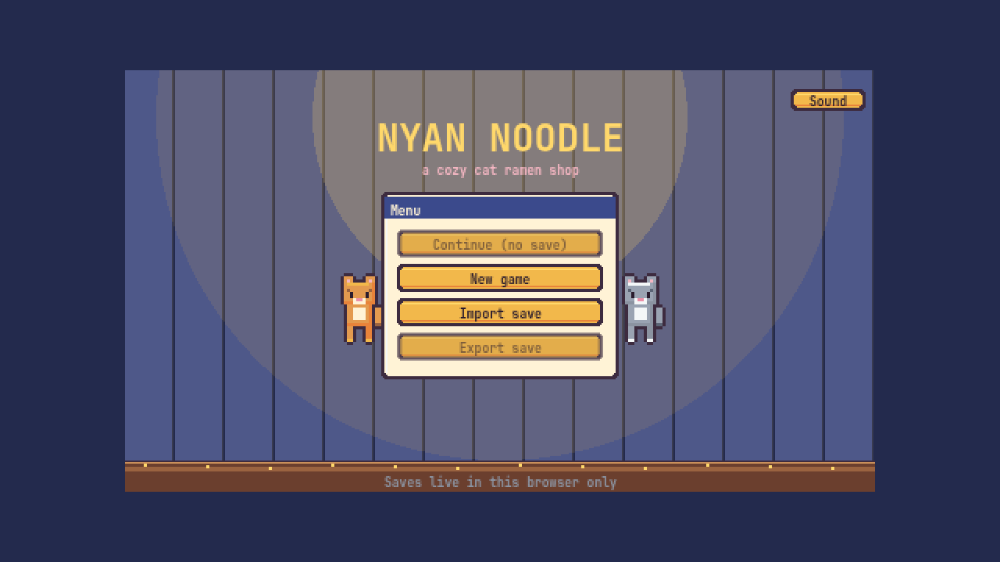
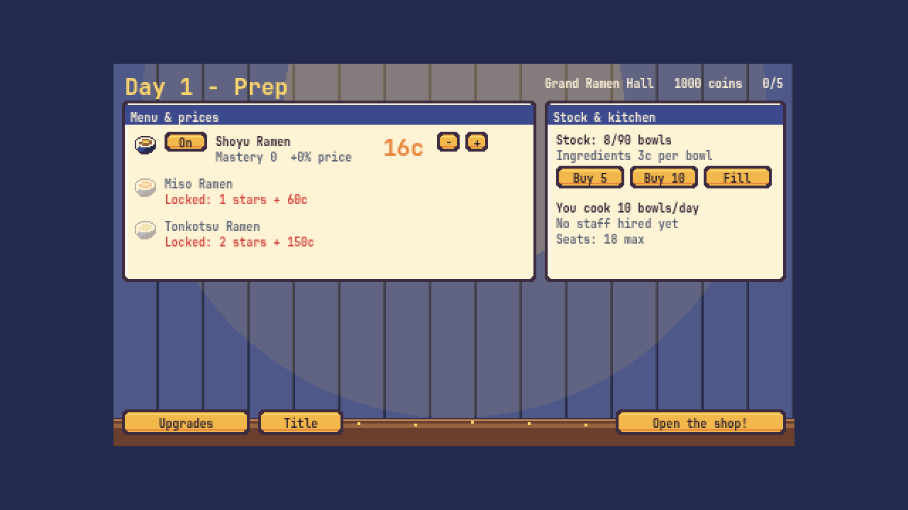
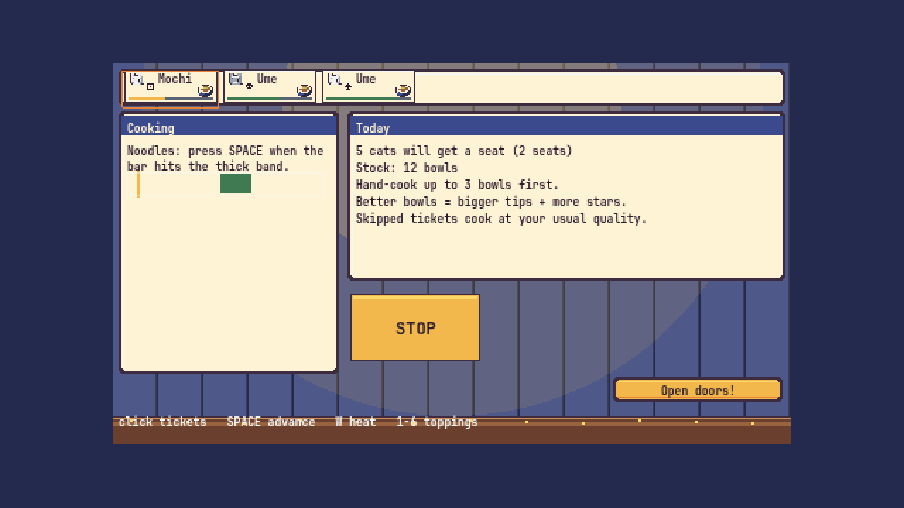
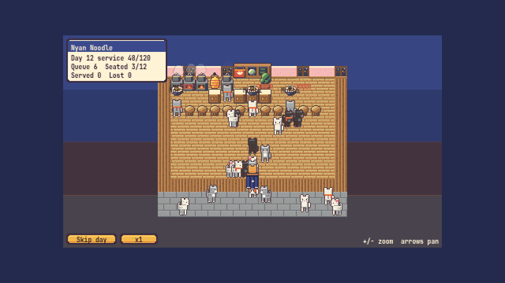
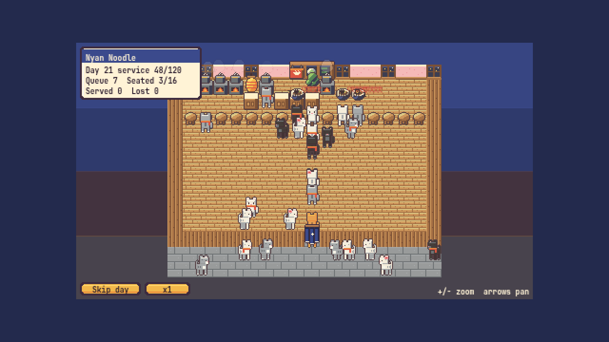
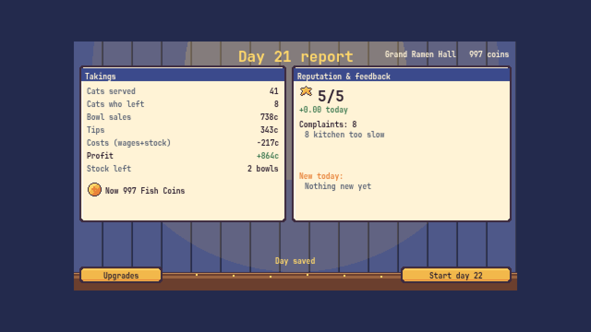
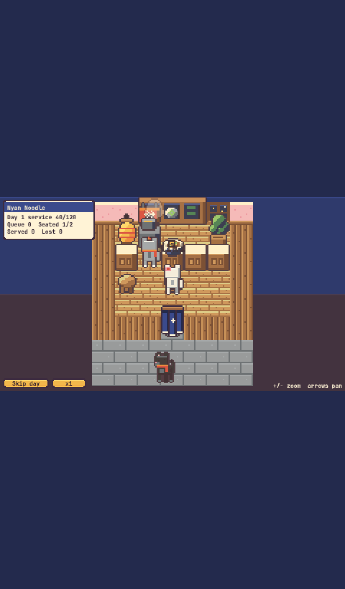
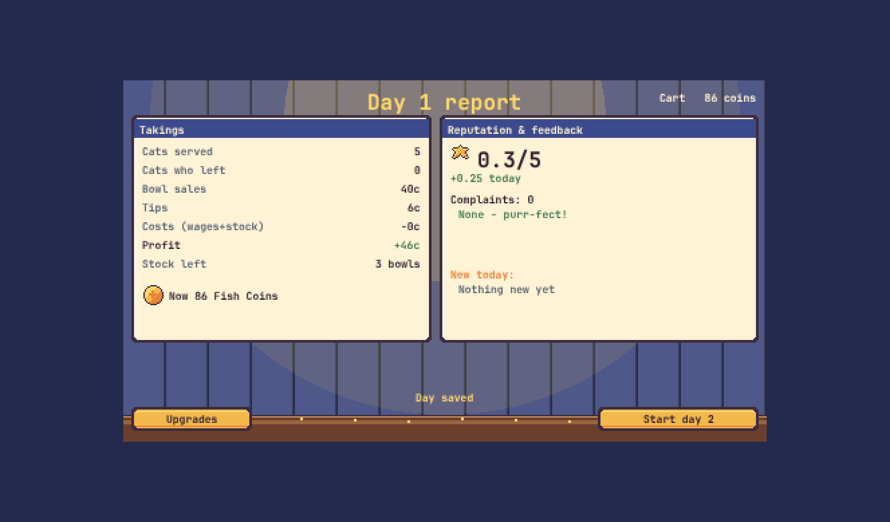

# Phase 2 playtest report

Exploratory playtest of `main` at `8a31be0` (Phase 2 complete: audio, regulars/breeds, Ramen Bar + Grand Hall, touch/responsive), run 2026-11-27.

## How it was played

| Session                       | How                                                                                                                                                                                                 |
| ----------------------------- | --------------------------------------------------------------------------------------------------------------------------------------------------------------------------------------------------- |
| Headless, days 1-30           | `autopilotRun` over the 8 balance seeds (1, 2, 3, 42, 99, 1337, 2024, 7777), per-tier means                                                                                                         |
| Desktop Chromium 1280x720     | `vite preview` build, 25 in-game days title -> prep -> kitchen -> service -> report, autopilot prep decisions, day 1 hand-cooked with real `SPACE` input, every tier's prep/service/report captured |
| iPhone 13 and Pixel 7 (touch) | Playwright device emulation, one full day in portrait, then rotated to landscape                                                                                                                    |
| Manual sampling               | Prep stock label read from the live Phaser text objects at Cart, Ramen Bar and Grand Hall; canvas fit/letterbox measured per viewport                                                               |
| Suites                        | `npm run check` (typecheck, lint, format, 212 Vitest tests, assets, build) and `npm run e2e` (16 Playwright specs, desktop + iPhone + Pixel)                                                        |

No page errors, console errors or failed requests in any browser session.

## Findings

| #   | Severity | Finding                                                                                                                                                                                                                                                                                                               | Status                                                                         |
| --- | -------- | --------------------------------------------------------------------------------------------------------------------------------------------------------------------------------------------------------------------------------------------------------------------------------------------------------------------- | ------------------------------------------------------------------------------ |
| F1  | High     | **Grand Hall made the shop worse.** The pantry was a flat `STOCK_CAP = 40` at every tier while a Grand Hall kitchen cooks 40-60 bowls; with the reference player also spending its stock money on upgrades, Grand Hall averaged 22.8 served / 31.8 lost (sold-out) a day vs Ramen Bar's 37.5 served. Takings fell 7%. | Fixed: per-tier pantry (`STOCK_CAP_BY_TIER`), autopilot keeps stock money back |
| F2  | Medium   | **Ramen Bar plateau.** Days ~14-21 serve exactly 39-40 cats a day with no complaints: 12 seats are full, stars are already maxed (5.0 by day ~12) and the only goal is saving 5500c. About a week of identical days.                                                                                                  | Proposed card P1                                                               |
| F3  | Medium   | **Stars cap at 5.0 around day 12** and then never move again; Reputation stops being a goal for the last 60% of the 30-day run.                                                                                                                                                                                       | Proposed card P1 (prestige branches give stars a second life)                  |
| F4  | Low      | **Phone landscape renders at 1x.** On a 664x390 landscape phone the 480x270 frame stays at integer 1x (50% of the screen is backdrop, 8px text); portrait already uses the exact fractional fit. `mobile.spec.ts` pins landscape `integer === true`, so this is a product choice (crisp pixels vs fill).              | Proposed card P2                                                               |
| F5  | Low      | **Kitchen e2e is load-sensitive.** `service.spec.ts` / `shop.spec.ts` failed once under 8 local workers (the sandbox ticket clock is real-time, so a slow frame expires the ticket); both pass 4/4 serially and CI runs one worker.                                                                                   | Proposed card P3                                                               |
| F6  | Info     | Desktop letterbox: 1280x720 renders the frame at 2x (960x540) with 44% backdrop. Expected under the integer-zoom rule.                                                                                                                                                                                                | No action                                                                      |

## Balance table (30 days, 8 seeds, reference autopilot)

First day served in each tier:

| Seed | Cart | Stall | Small Shop | Ramen Bar | Grand Hall |
| ---- | ---- | ----- | ---------- | --------- | ---------- |
| 1    | 1    | 3     | 7          | 12        | 22         |
| 2    | 1    | 3     | 6          | 12        | 21         |
| 3    | 1    | 3     | 6          | 12        | 21         |
| 42   | 1    | 3     | 7          | 13        | 22         |
| 99   | 1    | 3     | 7          | 13        | 22         |
| 1337 | 1    | 3     | 7          | 13        | 22         |
| 2024 | 1    | 3     | 7          | 12        | 22         |
| 7777 | 1    | 3     | 8          | 13        | 23         |

Per-tier daily means (all seeds), `main` (8a31be0) -> this PR (measured at fcc34cf, after the per-purchase stock-reserve fix):

| Tier       | Takings (rev + tips) | Served           | Lost            |
| ---------- | -------------------- | ---------------- | --------------- |
| Cart       | 62.1 -> 62.1         | 6.0 -> 6.0       | 0.1 -> 0.1      |
| Stall      | 157.5 -> 157.5       | 10.1 -> 10.1     | 1.4 -> 1.4      |
| Small Shop | 423.0 -> 427.0       | 22.5 -> 22.8     | 6.0 -> 5.8      |
| Ramen Bar  | 819.9 -> 828.3       | 37.5 -> 37.8     | 2.3 -> 2.1      |
| Grand Hall | **764.9 -> 1831.6**  | **22.8 -> 54.2** | **31.8 -> 3.6** |

Each tier now earns at least 1.3x the previous one; `balance.test.ts` pins that, the Ramen Bar (days 11-14) and Grand Hall (days 20-25) windows, and no sell-outs at the two big tiers. The Cart -> Small Shop curve is unchanged.

## Proposed cards

- **P1 Mid/late-game goals:** give Ramen Bar a mid-tier goal (regular-cat requests, seasonal dish, or a decor milestone) and give stars a use past 5.0 (prestige "open a new branch"). Folds into Phase 3 events/seasons and prestige.
- **P2 Phone landscape scaling:** decide crisp 1x vs exact fill for 1 <= zoom < 2; if fill, change `computeViewportFit` and the `mobile.spec.ts` landscape assertion together.
- **P3 Deterministic kitchen e2e:** add a debug `pauseClock()` to the service sandbox so `service.spec.ts` can't expire a ticket under load.

## Screenshots

|                                                            |                                                               |
| ---------------------------------------------------------- | ------------------------------------------------------------- |
|                                      |  |
|                      |                 |
|            |                 |
|  |     |
